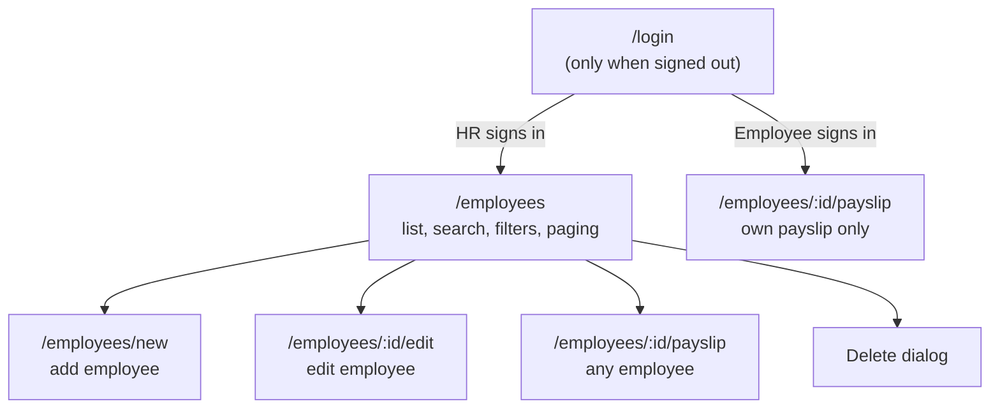
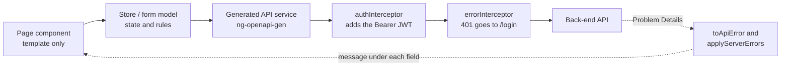
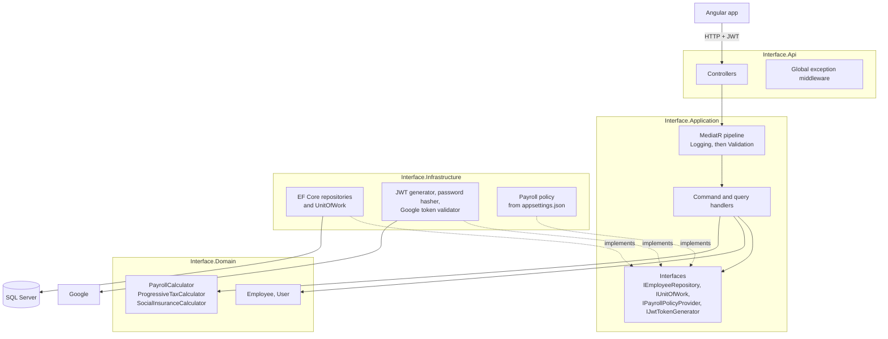
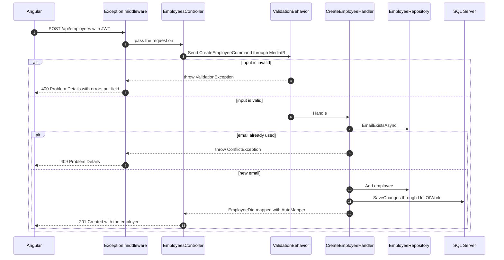
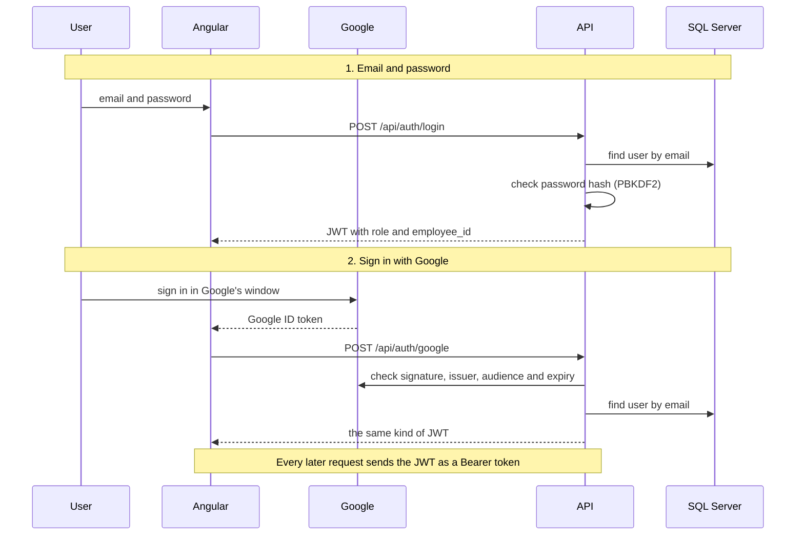
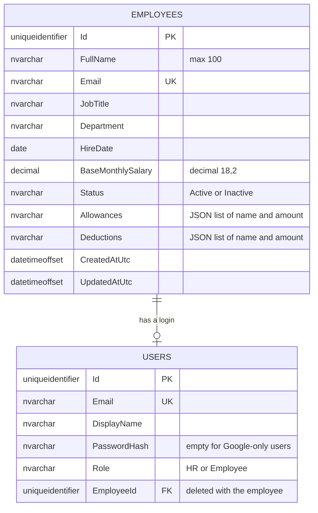
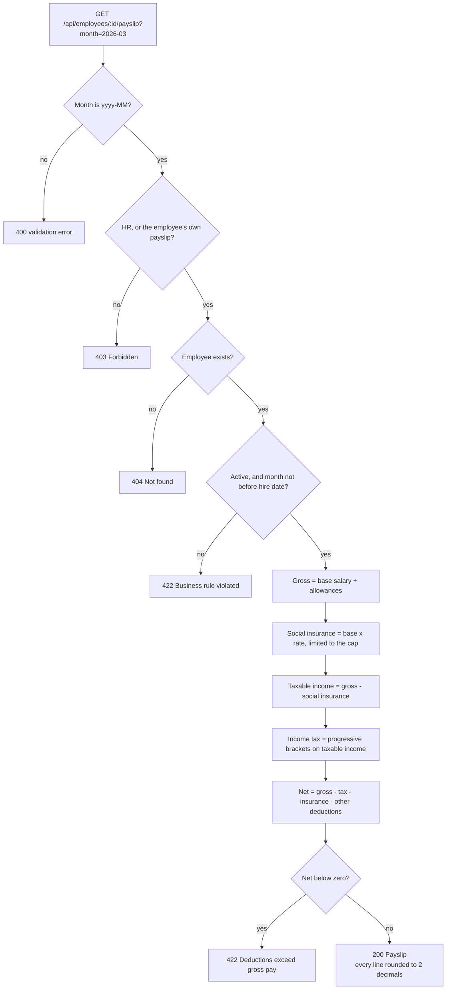
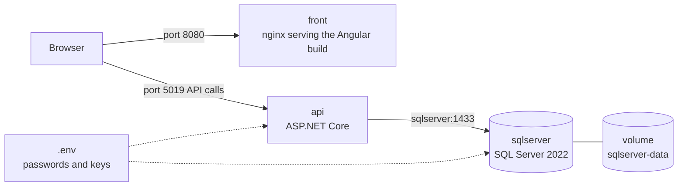

# Interface - Employee Management & Payroll

A full-stack application for managing employees and calculating monthly payslips.

| Part | Folder | Stack | Status |
| --- | --- | --- | --- |
| Backend API | [`back/`](back/) | ASP.NET Core Web API (.NET 9), EF Core 9 + SQL Server | Done |
| Frontend | [`Front/`](Front/) | Angular 21, TypeScript, SCSS, API client generated from Swagger with ng-openapi-gen | Done |

The assessment brief is in [`docs/Interface_Code_Assessment_2026.md`](docs/Interface_Code_Assessment_2026.md).

---

## Quick start with Docker (recommended)

Prerequisites: Docker Desktop. Nothing else: SQL Server runs in a container.

```powershell
Copy-Item .env.example .env      # then put your own values in .env (it is git-ignored)
docker compose up --build -d
```

- **App: http://localhost:8080**
- API + Swagger: http://localhost:5019/swagger
- SQL Server: `localhost,1434` (user `sa`, password from `.env`), data kept in the `sqlserver-data` volume

On first start the API waits until SQL Server is healthy, applies the migrations and seeds the demo data.
Stop with `docker compose down`; add `-v` to also delete the database.

The images:
- [`back/Dockerfile`](back/Dockerfile): multi-stage build (SDK image to publish, small ASP.NET runtime image to run, as a non-root user).
- [`Front/Dockerfile`](Front/Dockerfile): Node image builds the Angular app, nginx serves it ([`Front/nginx.conf`](Front/nginx.conf) sends unknown paths to `index.html` so deep links work).
- [`docker-compose.yml`](docker-compose.yml) wires SQL Server 2022, the API and the front end. Every secret comes from `.env`.

| Demo account | Password | Role |
| --- | --- | --- |
| `hr@interface.local` | `Demo@12345` | HR: everything |
| `sara.ali@interface.local` | `Demo@12345` | Employee: only her own payslip |

The login page has buttons that fill these in. They are demo-only accounts, created only when seeding is switched on
(`appsettings.Development.json` locally, `Seed__Enabled` in `docker-compose.yml`).

## Quick start without Docker (backend)

Prerequisites: .NET SDK 9, and SQL Server reachable at `Server=.` with Windows authentication.
(Use a different server by setting `ConnectionStrings__Default`; see [`back/.env.example`](back/.env.example).)

```powershell
cd back
dotnet run --project src/Interface.Api --launch-profile http
```

That one command builds the API, applies the EF Core migrations, seeds the demo accounts above and opens Swagger at
http://localhost:5019/swagger.

## Quick start without Docker (frontend)

Prerequisites: Node.js 22 or later, and the API running on http://localhost:5019 (either way above).

```powershell
cd Front
npm install
npm start
```

Open http://localhost:4200. The API URL and the Google client ID are in
[`Front/src/environments/environment.ts`](Front/src/environments/environment.ts).

## Tests

```powershell
cd back; dotnet test          # 78 backend unit tests (xUnit)
```
```powershell
cd Front; npm test -- --watch=false   # 33 frontend unit tests (Vitest), including component tests
```

### Optional settings (user-secrets or environment variables, never committed)

```powershell
cd back/src/Interface.Api
dotnet user-secrets set "Jwt:SigningKey" "<at least 32 random characters>"
dotnet user-secrets set "Seed:GoogleHrEmails:0" "you@gmail.com"
```

- Without `Jwt:SigningKey`, Development uses a random key per run, so tokens stop working after a restart.
  Outside Development the API refuses to start without one.
- **Google sign-in is configured** with an OAuth 2.0 Web client ID (authorised JavaScript origins
  `http://localhost:4200` and `http://localhost:8080`, no redirect URIs). The client ID is a public identifier,
  not a secret, so it is committed in two places that must match: `Authentication:Google:ClientId` in
  [`appsettings.json`](back/src/Interface.Api/appsettings.json) (the API checks Google tokens were issued for it)
  and `googleClientId` in [`environment.ts`](Front/src/environments/environment.ts) (the button).
  To use your own Google project, replace it in both. The client **secret** is not used and must never be committed.
- Only Google accounts whose email already exists as a user can sign in. Add your Gmail as an HR user with
  `Seed:GoogleHrEmails` (user-secrets above) or `GOOGLE_HR_EMAIL` in `.env` for Docker; it is created on the next start.

---

## API overview

| Method | Route | Who | Description |
| --- | --- | --- | --- |
| POST | `/api/auth/login` | anyone | Email + password, returns a JWT |
| POST | `/api/auth/google` | anyone | Google ID token, returns our JWT |
| GET | `/api/auth/me` | signed in | The current user |
| GET | `/api/employees?search=&department=&status=&page=1&pageSize=10` | HR | Paged list. `search` matches name or email |
| GET | `/api/employees/departments` | HR | Distinct departments, for the filter |
| GET | `/api/employees/{id}` | HR | One employee |
| POST | `/api/employees` | HR | Create (201 + Location header) |
| PUT | `/api/employees/{id}` | HR | Update |
| DELETE | `/api/employees/{id}` | HR | Delete (204) |
| GET | `/api/employees/{id}/payslip?month=2026-03` | HR, or the employee themself | Monthly payslip |
| GET | `/health` | anyone | Health check, including the database |

### Errors: RFC 7807 Problem Details

Every error has the same shape, written in one place: [`GlobalExceptionHandlingMiddleware`](back/src/Interface.Api/Middleware/GlobalExceptionHandlingMiddleware.cs).
Handlers and controllers contain no `try/catch`.

| Status | When | Source |
| --- | --- | --- |
| 400 | Validation failed; `errors` maps each camelCase field to its messages | FluentValidation `ValidationException` |
| 401 | Not signed in, bad credentials, bad Google token | JWT middleware / `AuthenticationFailedException` |
| 403 | Signed in but not allowed (e.g. an employee asking for another payslip) | Policy / `ForbiddenAccessException` |
| 404 | Employee not found | `NotFoundException` |
| 409 | Email already used | `ConflictException` (and SQL unique-index violations) |
| 422 | Valid request that breaks a business rule (inactive employee, month before hire) | `BusinessRuleViolationException` |
| 500 | Anything unexpected; details shown only in Development | fallback |

```json
{
  "type": "https://tools.ietf.org/html/rfc9110#section-15.5.1",
  "title": "One or more validation errors occurred.",
  "status": 400,
  "detail": "See the errors property for details.",
  "traceId": "00-...",
  "errors": { "email": ["Email must be a valid email address."], "allowances[0].amount": ["Amount cannot be negative."] }
}
```

Business errors also carry a machine-readable `code`, e.g. `payroll.employee_inactive` or `employee.email_taken`.

---

## Authentication (Task 5)

The brief asks for one of "SSO with an identity provider" or "JWT with at least two roles". The app has **both**:
two ways to sign in, and both end with the same JWT issued by our API.

| | 1. Email + password | 2. Sign in with Google |
| --- | --- | --- |
| Endpoint | `POST /api/auth/login` | `POST /api/auth/google` |
| The user gives | Email and password | Their Google account, in Google's own sign-in window |
| The server checks | Password against a PBKDF2 hash (ASP.NET Core Identity's `PasswordHasher`) | The Google ID token's signature, expiry, issuer and audience (our client ID), with `Google.Apis.Auth`; the email must be verified |
| Who may sign in | Users with a password | Only Google accounts whose email already exists as a user (no self-registration) |
| Result | Our JWT (60 minutes) | The same JWT |

```
Password:  Angular ──email+password──► POST /api/auth/login ──► check hash ──────────┐
                                                                                    ├──► JWT (sub, email, role, employee_id)
Google:    Angular ──Google button──► Google ──ID token──► POST /api/auth/google ──► verify token, find user by email ──┘
```

After sign-in, every request sends `Authorization: Bearer <JWT>` (added by the Angular `authInterceptor`).
Because both methods produce the same token, the rest of the API only has to understand one kind of token.

**Roles and permissions (enforced on the server):**

| Role | Can do |
| --- | --- |
| `HR` | Everything: list, create, edit and delete employees; view any payslip |
| `Employee` | View only their own payslip (`employee_id` claim must match); any other call returns 403 |

- Every endpoint requires a signed-in user unless marked `[AllowAnonymous]` (login, Google login, health).
- Employee endpoints use the `HrOnly` policy; the payslip handler checks HR-or-own-payslip before loading anything.
- The Angular route guards hide pages the user cannot use, but they are only for convenience: the API decides.

---

## Backend architecture

Clean Architecture: dependencies point inwards only.

```
back/
├── src/
│   ├── Interface.Domain          Entities, value objects, payroll rules. No framework dependencies.
│   ├── Interface.Application     Use cases (CQRS), interfaces it needs, DTOs, validation, mapping
│   ├── Interface.Infrastructure  EF Core, repositories, JWT/Google/password services, configuration
│   └── Interface.Api             Controllers, global error middleware, auth setup, Swagger
└── tests/
    └── Interface.UnitTests       Domain and application tests; no database, no network
```

```
Api ──► Application ──► Domain
 │            ▲
 └──► Infrastructure (implements Application interfaces)
```

- **Domain** holds the business rules: `Employee`, `PayrollCalculator`, `ProgressiveTaxCalculator`,
  `SocialInsuranceCalculator`, `PayrollPolicy`, `PayrollPeriod`, `Money`. It references nothing, so the payroll
  logic is tested as plain C#.
- **Application** has one folder per feature (`Employees`, `Payroll`, `Auth`). Each use case is a MediatR
  command or query with its own handler and validator (CQRS). It declares the interfaces it needs
  (`IEmployeeRepository`, `IUnitOfWork`, `IPayrollPolicyProvider`, `IJwtTokenGenerator`, `ICurrentUser`, ...).
  Two pipeline behaviours run around every request: logging and validation.
- **Infrastructure** implements those interfaces with EF Core, `Microsoft.AspNetCore.Identity`'s password hasher,
  `System.IdentityModel.Tokens.Jwt` and `Google.Apis.Auth`.
- **Api** is thin: each action maps the HTTP request to a command or query and sends it.
- **Dependency injection**: each layer has one static registration class with one extension method:
  `ApplicationServiceRegistration.AddApplication()`, `InfrastructureServiceRegistration.AddInfrastructure()`,
  `PresentationServiceRegistration.AddPresentation()`. `Program.cs` only chains them.

### Why these choices

| Choice | Reason |
| --- | --- |
| Clean Architecture | Business rules stay independent of EF Core, ASP.NET Core and SQL Server, so they are testable in isolation and the infrastructure can be swapped |
| CQRS with MediatR | One small class per use case; cross-cutting concerns (validation, logging) live in pipeline behaviours instead of every handler. Pinned to MediatR 12.5 (Apache 2.0); later versions need a commercial licence |
| AutoMapper | Entity → DTO and HTTP request → command mapping without hand-written copy code. A test asserts every map is valid. Version 16.3: 14.x has known high-severity advisories and 17.x requires .NET 10. Takes an optional licence key |
| FluentValidation | Validation rules live next to each use case, are unit-testable and shared between create and update |
| Write side through the domain, read side via mapping | Commands go through `Employee.Create`/`UpdateDetails` (private setters protect invariants); queries map entities to DTOs |
| Repository + Unit of Work | Handlers depend on interfaces, so tests use NSubstitute fakes instead of a database |
| Allowances/deductions as JSON columns | They are always read and written with their employee; no extra tables or joins |
| Payroll policy from configuration | Tax brackets, insurance rate and cap are in `appsettings.json` (`Payroll` section), validated at startup and reloaded on change |
| JWT + Google | Our own short-lived JWT for every request. Google sign-in verifies the Google ID token on the server, then issues our JWT, so the API only ever validates one token type |
| Serilog | Structured logs (JSON outside Development) and request logging |

### Extending it

- **New deduction type** (e.g. pension): add an `IPensionCalculator` in the domain, call it from `PayrollCalculator`,
  and add its settings to `PayrollOptions`. Fixed per-employee deductions need no code: they are data.
- **New tax rules**: change the `Payroll:TaxBrackets` configuration, or register another `ITaxCalculator`.
- **New module** (leave, attendance): add a `Features/Leave` folder in Application, an entity in Domain, a
  repository in Infrastructure and a controller. Nothing existing changes.

---

## Frontend architecture

Angular 21 with standalone components, signals and zoneless change detection. Pages are lazy-loaded.

```
Front/src/app/
├── core/                       App-wide, created once
│   ├── api/generated/          Typed API client generated from Swagger (do not edit by hand)
│   ├── auth/                   SessionService (JWT + user), auth interceptor, route guards, Google sign-in loader
│   ├── http/                   Error interceptor and Problem Details → ApiError conversion
│   ├── layout/                 Shell: header, navigation, user menu
│   └── notifications/          Toast messages
├── shared/                     Reusable, no business knowledge
│   ├── forms/                  Validators, server-error mapping, <app-field-error>
│   └── ui/                     Pagination, confirm dialog
└── features/                   One folder per screen
    ├── auth/                   Login page (email/password + Google button)
    ├── employees/              List (+ EmployeeListStore), create/edit form (+ form model)
    └── payslip/                Monthly payslip page
```

- **The API client is generated, not hand-written.** [ng-openapi-gen](https://github.com/cyclosproject/ng-openapi-gen)
  reads the backend's Swagger document and writes typed Angular services and models (`EmployeesService`,
  `EmployeeDto`, `PayslipDto`, ...). After an API change: start the API, then run `npm run api:update`.
  The downloaded spec is committed in [`Front/openapi/`](Front/openapi/), so `npm run api:generate` works offline.
- **No business logic in components.** Components only bind the template. State and loading live in a store
  (`EmployeeListStore`), form rules and request building in a form model (`employee-form.model.ts`), auth in
  `SessionService`. Payroll calculation stays on the server; the UI only displays the payslip.
- **Validation on both sides.** The forms repeat the API's rules (required, max length, email, hire date not in the
  future, salary > 0, at most 2 decimals) for instant feedback. The API still validates everything. If the server
  rejects a request, its Problem Details `errors` are put on the matching inputs (`applyServerErrors`), e.g.
  "email already exists" appears under the Email field.
- **Error handling in one place.** `errorInterceptor` sends the user to the login page when the token is rejected;
  `toApiError` turns any HTTP failure into one shape the pages display.
- **Auth.** The JWT is kept in `localStorage` and added to API calls by `authInterceptor` (only for our API's URL).
  Guards decide what the UI shows (HR pages, an employee's own payslip); the API enforces the same rules.
- **Styling.** Plain SCSS with design tokens (CSS variables) in `styles.scss`, plus a small stylesheet per component.
  No UI kit: the app needs a few buttons, forms and tables, which do not justify a large dependency.
- **Google sign-in** uses Google's own script directly (two calls), so no wrapper package is needed.

| Library | Why |
| --- | --- |
| ng-openapi-gen (dev only) | Generates the typed API client from Swagger, so the front end cannot drift from the API |
| Vitest (Angular 21 default) | Unit and component tests |

---

## Wireframes and diagrams

Screens are drawn as text wireframes of the real UI. Diagrams use Mermaid, which GitHub draws automatically.

### Front end

#### Login

```text
┌────────────────────────────────────────────────┐
│                     [ I ]                      │
│               Interface Payroll                │
│   Sign in to manage employees and payslips.    │
│                                                │
│ Email                                          │
│ ┌────────────────────────────────────────────┐ │
│ │                                            │ │
│ └────────────────────────────────────────────┘ │
│ Password                                       │
│ ┌────────────────────────────────────────────┐ │
│ │ ••••••••••                                 │ │
│ └────────────────────────────────────────────┘ │
│ ┌────────────────────────────────────────────┐ │
│ │                  Sign in                   │ │
│ └────────────────────────────────────────────┘ │
│       ──────────────  or  ──────────────       │
│ ┌────────────────────────────────────────────┐ │
│ │          G   Sign in with Google           │ │
│ └────────────────────────────────────────────┘ │
│                                                │
│ ┌────────────────────────────────────────────┐ │
│ │ Demo accounts (password Demo@12345)        │ │
│ │ hr@interface.local        HR, full access  │ │
│ │ sara.ali@interface.local  Employee         │ │
│ └────────────────────────────────────────────┘ │
└────────────────────────────────────────────────┘
```

#### Employees (HR only)

```text
┌──────────────────────────────────────────────────────────────────────────────────────────────────┐
│ [I] Interface Payroll    [Employees]                          HR Administrator  (HR)  [Sign out] │
└──────────────────────────────────────────────────────────────────────────────────────────────────┘
┌──────────────────────────────────────────────────────────────────────────────────────────────────┐
│ Employees                                                                       [+ Add employee] │
│ Manage employee records and open their monthly payslips.                                         │
│                                                                                                  │
│ ┌────────────────────────────────┐  ┌──────────────────────┐  ┌──────────────────┐ ┌───────┐     │
│ │ Search: Name or email          │  │ All departments  ▼   │  │ All statuses ▼   │ │ Reset │     │
│ └────────────────────────────────┘  └──────────────────────┘  └──────────────────┘ └───────┘     │
│                                                                                                  │
│ ┌──────────────────────────────────────────────────────────────────────────────────────────────┐ │
│ │ EMPLOYEE                  JOB TITLE          DEPARTMENT   HIRE DATE    BASE SALARY  STATUS   │ │
│ │ ──────────────────────────────────────────────────────────────────────────────────────────── │ │
│ │ Ahmed Mostafa             HR Manager         Human Res.   Nov 26, 2020   35,000.00  Active   │ │
│ │ ahmed.mostafa@...                                         Payslip  Edit  Delete              │ │
│ │ Dina Fathy                Marketing Spec.    Marketing    Nov 26, 2024   16,000.00  Active   │ │
│ │ dina.fathy@...                                            Payslip  Edit  Delete              │ │
│ │ Tamer Nabil               Office Assistant   Operations   Nov 26, 2023    8,000.00  Inactive │ │
│ │ tamer.nabil@...                                           Payslip  Edit  Delete              │ │
│ │ ...                                                                                          │ │
│ │ ──────────────────────────────────────────────────────────────────────────────────────────── │ │
│ │ Showing 1–10 of 12                                     [Previous]  Page 1 of 2  [Next]       │ │
│ └──────────────────────────────────────────────────────────────────────────────────────────────┘ │
└──────────────────────────────────────────────────────────────────────────────────────────────────┘
```

#### Add / edit employee (HR only)

Errors appear under each field. The red message under Email came back from the API (409) and was put on that field.

```text
┌──────────────────────────────────────────────────────────────────────────────────────────────────┐
│ [I] Interface Payroll    [Employees]                          HR Administrator  (HR)  [Sign out] │
└──────────────────────────────────────────────────────────────────────────────────────────────────┘
┌──────────────────────────────────────────────────────────────────────────────────────────────────┐
│ ← Employees                                                                                      │
│ Add employee                                   (edit page: "Edit employee", fields pre-filled)   │
│                                                                                                  │
│ ┌──────────────────────────────────────────────────────────────────────────────────────────────┐ │
│ │ ! Please fix the highlighted fields.                                                         │ │
│ └──────────────────────────────────────────────────────────────────────────────────────────────┘ │
│ ┌──────────────────────────────────────────────────────────────────────────────────────────────┐ │
│ │ Employee details                                                                             │ │
│ │ Full name                                       Email                                        │ │
│ │ ┌──────────────────────────────────────────┐    ┌──────────────────────────────────────────┐ │ │
│ │ │ Ali Mansour                              │    │ sara.ali@interface.local                 │ │ │
│ │ └──────────────────────────────────────────┘    └──────────────────────────────────────────┘ │ │
│ │                                                 ! This email is already used (from API)      │ │
│ │ Job title                                       Department                                   │ │
│ │ ┌──────────────────────────────────────────┐    ┌──────────────────────────────────────────┐ │ │
│ │ │ Data Analyst                             │    │ Finance            (suggestions)         │ │ │
│ │ └──────────────────────────────────────────┘    └──────────────────────────────────────────┘ │ │
│ │ Hire date                                       Status                                       │ │
│ │ ┌──────────────────────────────────────────┐    ┌──────────────────────────────────────────┐ │ │
│ │ │ 2025-02-10        [calendar]             │    │ Active            ▼                      │ │ │
│ │ └──────────────────────────────────────────┘    └──────────────────────────────────────────┘ │ │
│ └──────────────────────────────────────────────────────────────────────────────────────────────┘ │
│ ┌──────────────────────────────────────────────────────────────────────────────────────────────┐ │
│ │ Pay                                                                                          │ │
│ │ Base monthly salary                                                                          │ │
│ │ ┌──────────────────────────────────────────┐                                                 │ │
│ │ │ 18500.50                                 │                                                 │ │
│ │ └──────────────────────────────────────────┘                                                 │ │
│ │ ────────────────────────────────────────────────────────────────────────────────────────     │ │
│ │ Allowances   (fixed monthly amounts added to gross pay)                                      │ │
│ │ ┌──────────────────────────────────────────────┐  ┌────────────────────────┐  ┌──────────┐   │ │
│ │ │ Name: Transport                              │  │ Amount: 1200           │  │ Remove   │   │ │
│ │ └──────────────────────────────────────────────┘  └────────────────────────┘  └──────────┘   │ │
│ │ [+ Add allowance]                                                                            │ │
│ │                                                                                              │ │
│ │ Other deductions   (taken from net pay; tax and insurance are automatic)                     │ │
│ │ None.                                                                                        │ │
│ │ [+ Add deduction]                                                                            │ │
│ └──────────────────────────────────────────────────────────────────────────────────────────────┘ │
│                                                                 [Cancel]  [Create employee]      │
└──────────────────────────────────────────────────────────────────────────────────────────────────┘
```

#### Delete confirmation

```text
┌────────────────────────────────────────────────────┐
│ Delete employee?                                   │
│                                                    │
│ This permanently deletes Ali Mansour and their     │
│ login. To keep the record, set the status to       │
│ Inactive instead.                                  │
│                                                    │
│                              [Cancel]  [Delete]    │
└────────────────────────────────────────────────────┘
```

#### Payslip (HR: any employee; Employee: own payslip only)

An employee sees the same page, with "My payslip" in the header and no link back to the employee list.

```text
┌──────────────────────────────────────────────────────────────────────────────────────────────────┐
│ [I] Interface Payroll    [Employees]                          HR Administrator  (HR)  [Sign out] │
└──────────────────────────────────────────────────────────────────────────────────────────────────┘
┌──────────────────────────────────────────────────────────────────────────────────────────────────┐
│ ┌──────────────────────────────────────────────────────────┐  ┌────────────────────────────────┐ │
│ │ ← Employees                                              │  │ Month: November 2026  [▼]      │ │
│ │ Payslip                                                  │  │                                │ │
│ │ Sara Ali                                                 │  │ [Print]                        │ │
│ └──────────────────────────────────────────────────────────┘  └────────────────────────────────┘ │
│ ┌──────────────────────────────────────────────────────────────────────────────────────────────┐ │
│ │ Employee: Sara Ali                                                       Pay period: 2026-11 │ │
│ └──────────────────────────────────────────────────────────────────────────────────────────────┘ │
│ ┌────────────────────────────────────────────┐  ┌────────────────────────────────────────────┐   │
│ │ Earnings                                   │  │ Deductions                                 │   │
│ │ ┌────────────────────────────────────────┐ │  │ ┌────────────────────────────────────────┐ │   │
│ │ │ Base salary                  25,000.00 │ │  │ │ Income tax (taxable 28,000)   1,800.00 │ │   │
│ │ │ Transport (allowance)         1,500.00 │ │  │ │ Social insurance              1,500.00 │ │   │
│ │ │ Housing (allowance)           3,000.00 │ │  │ │ Medical plan                    400.00 │ │   │
│ │ │ ────────────────────────────────────── │ │  │ │ ────────────────────────────────────── │ │   │
│ │ │ Gross pay                    29,500.00 │ │  │ │ Total deductions              3,700.00 │ │   │
│ │ └────────────────────────────────────────┘ │  │ └────────────────────────────────────────┘ │   │
│ └────────────────────────────────────────────┘  └────────────────────────────────────────────┘   │
│ ┌──────────────────────────────────────────────────────────────────────────────────────────────┐ │
│ │ NET PAY                                                                        25,800.00 EGP │ │
│ └──────────────────────────────────────────────────────────────────────────────────────────────┘ │
│                                                                                                  │
│ ┌──────────────────────────────────────────────────────────────────────────────────────────────┐ │
│ │ ! Business rule violated. A payslip cannot be generated for an inactive employee.            │ │
│ └──────────────────────────────────────────────────────────────────────────────────────────────┘ │
│   (shown instead of the payslip for an inactive employee or a month before the hire date)        │
└──────────────────────────────────────────────────────────────────────────────────────────────────┘
```

#### Pages and routes



#### How a page talks to the API



### Back end

#### Layers (Clean Architecture)

Arrows point in the direction of the dependency. Infrastructure implements the interfaces that Application declares.



#### One request, step by step (create an employee)



#### The two ways to sign in



#### Database tables



#### How a payslip is calculated



### Deployment

#### Docker Compose



---

## Payroll rules

```
gross            = base salary + allowances
social insurance = min(base salary x rate, cap)          cap optional
taxable income   = gross - social insurance              set SocialInsuranceReducesTaxableIncome=false to tax gross
income tax       = progressive brackets on taxable income
net              = gross - income tax - social insurance - other deductions
```

Default configuration (illustrative numbers, not any real country's rules):

| Taxable monthly income | Rate |
| --- | --- |
| 0 - 10,000 | 0% |
| 10,000.01 - 30,000 | 10% |
| 30,000.01 - 50,000 | 15% |
| above 50,000 | 20% |

Social insurance: 11% of base salary, capped at 1,500 per month. Currency: EGP.

**Rounding rule.** Money is `decimal`, never `double`: `decimal` is base-10, so amounts like 0.10 are exact.
Every payslip component (base salary, each allowance, social insurance, income tax, each deduction) is rounded to 2 decimals
**half away from zero** (`MidpointRounding.AwayFromZero`, the usual commercial rule, rather than .NET's default banker's rounding).
Totals are then summed from the rounded components, so the lines on a payslip always add up exactly to gross, total deductions and net.
The database stores money as `decimal(18,2)` and the API rejects inputs with more than 2 decimal places.

**Edge cases handled**

| Case | Behaviour |
| --- | --- |
| Inactive employee | 422 `payroll.employee_inactive` |
| Month before the hire month | 422 `payroll.period_before_hire_date` |
| Hired during the month | Paid the full month (no proration) |
| Zero allowances / zero deductions | Gross = base salary |
| Income exactly on a bracket boundary | Taxed at the lower bracket (bounds are inclusive) |
| Insurance above the cap | Cut to the cap |
| Deductions larger than gross | 422 `payroll.deductions_exceed_gross_pay` instead of a negative net |
| Invalid month (`2026-13`, `March`) | 400 validation error |
| Invalid configuration (brackets not ascending, rate > 100%) | The API refuses to start |

---

## Assumptions

- Salaries, allowances and deductions are **monthly fixed amounts** in one currency.
- A payslip is **calculated on demand** and not stored; it always uses the current configuration.
- Social insurance is a percentage of **base salary only** (not allowances), and the cap limits the contribution amount.
- Social insurance is deducted before tax (configurable).
- No proration for joining or leaving mid-month.
- Future months can be calculated (useful for forecasts).
- Employees are deleted permanently, together with their login, if they have one. Deactivating (status Inactive) is the soft alternative.
- Only users who already exist can sign in with Google. There is no self-registration.
- Emails are compared case-insensitively (stored lowercase).

## Known limitations / next steps

- Payslips are not persisted or versioned. Next: store issued payslips so later configuration changes do not alter history.
- One payroll policy for everyone. Next: policies per country or entity, with effective dates.
- No refresh tokens. The access token simply expires (60 minutes).
- HR cannot yet create login accounts for employees from the API; demo accounts come from the seed.
- Integration tests (WebApplicationFactory + Testcontainers SQL Server) are not done yet.
- No CI/CD pipeline (left out on purpose for this assessment); tests run locally.
- The JWT is stored in `localStorage`, which an XSS bug could read. Next: an HttpOnly cookie with refresh tokens.
- The front end's API URL and Google client ID are compiled in. Next: load them from a runtime `config.json`.
- No end-to-end browser tests (e.g. Playwright); the flows were checked by hand.
- No audit log of who changed what (only created/updated timestamps).

## AI usage

I used **Claude Code** as a tool to improve my work: to move faster (it wrote code from my instructions and
design), to raise the quality (reviewing and fixing problems it found), and to test all the cases (111 unit tests,
plus hand testing of every endpoint and screen). Details: [`ai-usage/README.md`](ai-usage/README.md).
